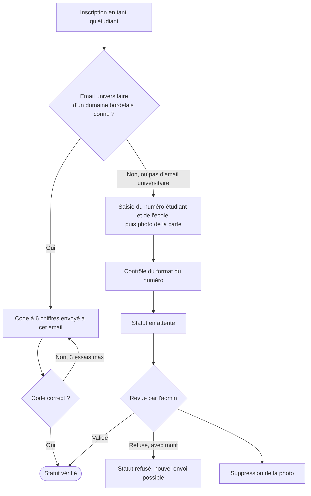
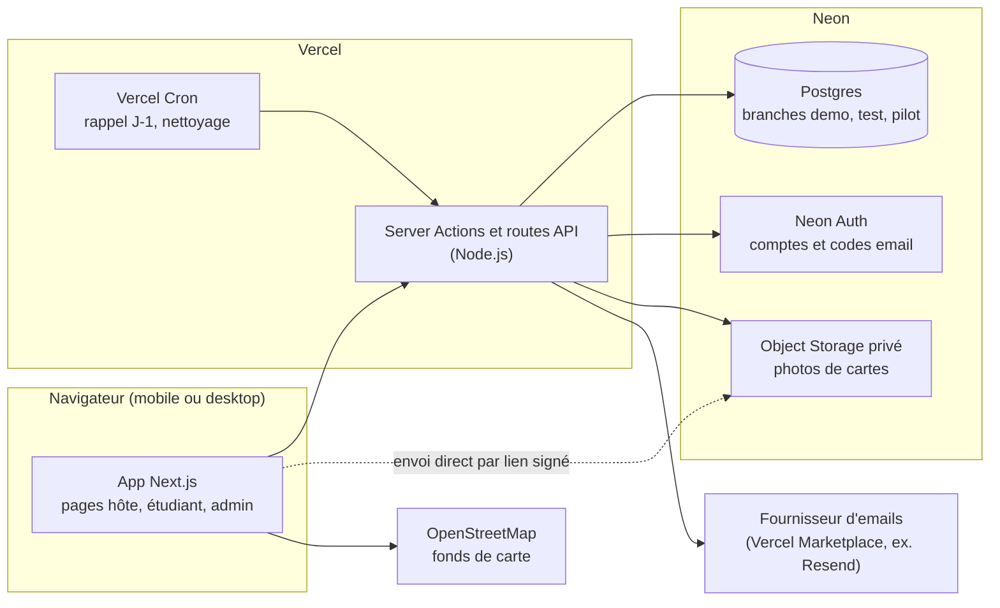
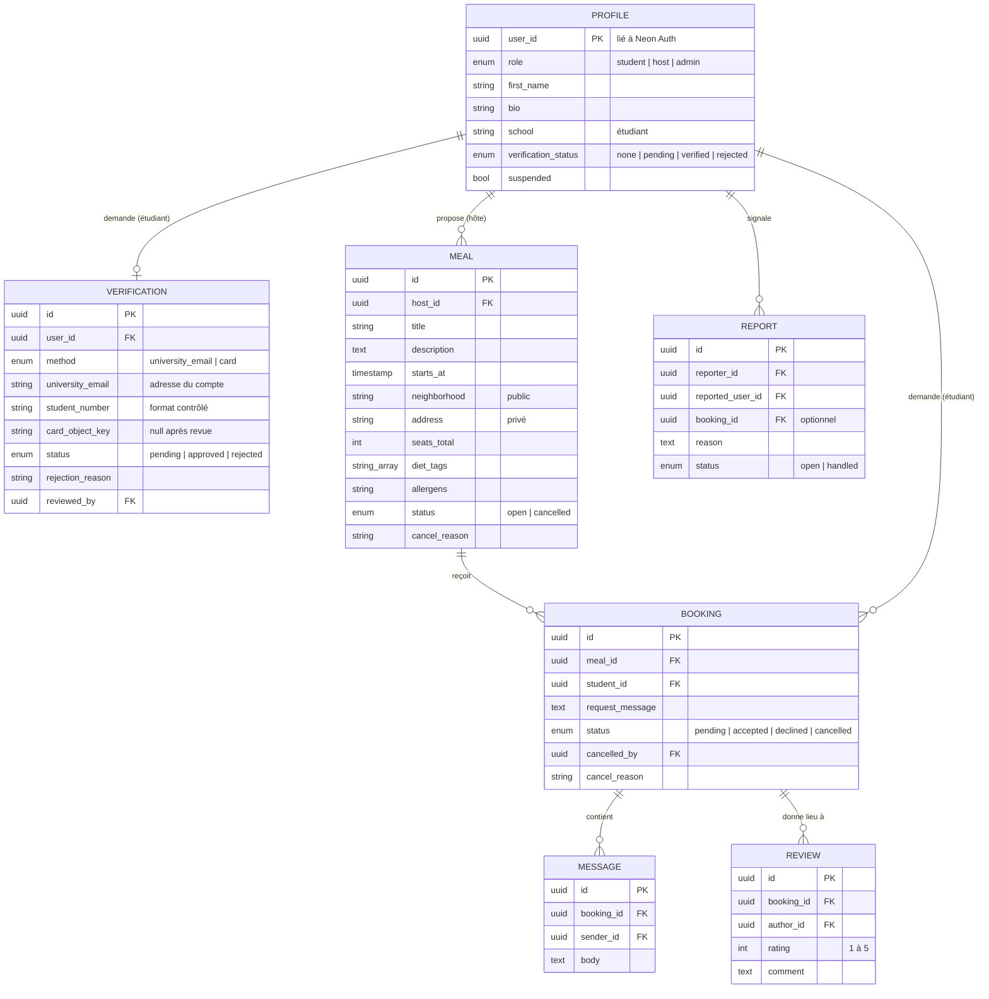
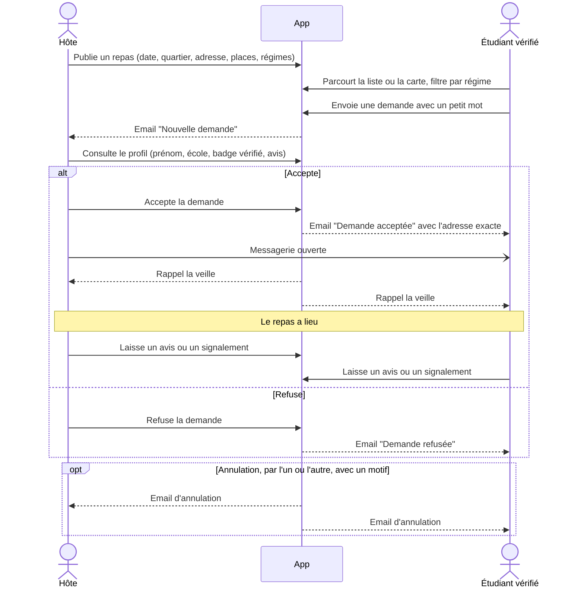
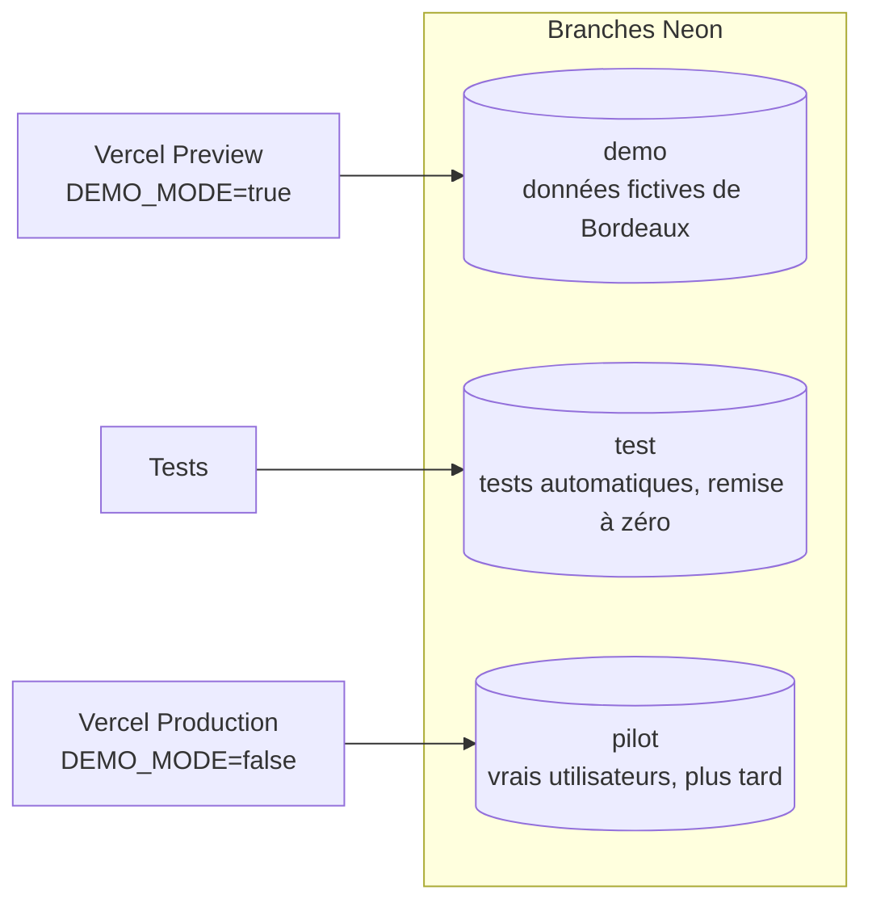

# Ocleans — Repas solidaires entre habitants et étudiants (prototype)

- **Date** : 2026-10-21
- **Statut** : design validé, en attente de relecture de la spec
- **Ville pilote** : Bordeaux

## 1. Contexte et objectif

De plus en plus d'étudiants français dépendent des associations et banques alimentaires pour se nourrir. Ocleans part d'un constat simple : les gens sont solidaires et cherchent du lien social. Une famille, une personne âgée ou tout autre habitant peut cuisiner **une portion de plus** et la **partager à table** avec un étudiant. L'étudiant, souvent sans ressources, réserve un créneau et vient partager ce repas.

Le repas est **partagé sur place**, il ne s'agit pas d'un panier à emporter. Le lien social compte autant que la nourriture. L'application est **gratuite**, sans aucun paiement.

### Objectif du prototype

1. **D'abord** : une démo propre, partageable par un lien, avec des données fictives bordelaises, pour itérer à deux (les deux porteurs du projet).
2. **Ensuite** : la même base de code sert à un **test grandeur nature** avec de vrais hôtes et étudiants à Bordeaux, sans réécriture. On ne change que la configuration.

### Critères de succès

- Un hôte peut publier un repas. Un étudiant vérifié peut le trouver (liste ou carte), envoyer une demande, être accepté, échanger des messages, recevoir un rappel, puis laisser un avis.
- La vérification étudiante fonctionne de bout en bout par email universitaire **et** par carte étudiante validée par un admin.
- L'adresse exacte de l'hôte n'est jamais visible avant l'acceptation d'une demande.
- La démo est utilisable en moins d'une minute grâce aux comptes de démonstration.
- Le passage en mode test réel ne nécessite aucune modification de code.

## 2. Utilisateurs et rôles

| Rôle | Qui | Peut |
|---|---|---|
| `host` | Familles, personnes âgées, tout habitant volontaire | Publier, modifier et annuler des repas ; accepter ou refuser des demandes ; échanger des messages ; laisser des avis et des signalements |
| `student` | Étudiants à Bordeaux | Se vérifier ; parcourir et filtrer les repas ; envoyer des demandes (une fois vérifié) ; annuler ; échanger des messages ; laisser des avis et des signalements |
| `admin` | Les porteurs du projet | Valider ou refuser les cartes étudiantes ; traiter les signalements ; suspendre des comptes |

Le rôle `student` ou `host` est choisi à l'inscription. Le rôle `admin` est attribué manuellement (script ou base de données).

## 3. Périmètre fonctionnel

### 3.1 Socle
- Comptes et connexion (Neon Auth), avec un rôle choisi à l'inscription et un profil (prénom, courte bio, école pour un étudiant).
- Vérification étudiante (§4).
- Écran admin de validation des cartes.
- Publication d'un repas : titre, description du plat, date et heure, quartier (dans une liste fermée des quartiers de Bordeaux et de la métropole), adresse exacte, nombre de places.
- Liste des repas à venir, demande avec un petit mot, acceptation ou refus par l'hôte.
- « Mes repas », côté étudiant et côté hôte.

### 3.2 Options (toutes incluses dans le prototype)
- **A. Régimes et allergies** : l'hôte coche des étiquettes (végétarien, végan, halal, casher, sans gluten, sans lactose, sans porc) et peut préciser les allergènes en texte libre. L'étudiant filtre les repas par étiquette.
- **B. Notifications par email** : nouvelle demande (à l'hôte), demande acceptée avec l'adresse (à l'étudiant), demande refusée, annulation (à l'autre partie), rappel la veille (aux deux), résultat de la vérification (à l'étudiant).
- **C. Carte** : Leaflet + OpenStreetMap. Chaque repas est placé au **centre de son quartier**, jamais à l'adresse exacte. On peut basculer entre la liste et la carte.
- **D. Messagerie** : un fil par réservation acceptée, ouvert uniquement aux deux participants et rafraîchi toutes les 5 secondes. Le fil passe en lecture seule 7 jours après le repas, ou dès l'annulation.
- **E. Avis et signalement** : après l'heure du repas, sur une réservation acceptée, chaque participant peut laisser une note de 1 à 5 avec un commentaire facultatif (au maximum un avis par personne et par réservation). Un signalement est possible à tout moment depuis un profil ou une réservation.
- **F. Annulation** : l'hôte peut annuler un repas, ce qui annule en cascade toutes les réservations liées. L'étudiant peut annuler sa demande ou sa réservation. Dans les deux cas, un motif est obligatoire et l'autre partie est notifiée.

### 3.3 Hors périmètre
Paiement, application native, notifications push, temps réel instantané, autres villes que Bordeaux et sa métropole, lecture automatique (OCR) des cartes, vérification de l'identité des hôtes.

## 4. Vérification étudiante

Il n'existe pas, à notre connaissance, d'API publique permettant de vérifier qu'un numéro étudiant ou un INE existe réellement. Le prototype combine donc deux méthodes :

1. **Email universitaire (méthode principale)** : l'étudiant **crée son compte avec son adresse universitaire**, dont le domaine doit figurer dans une liste configurable (`src/config/university-domains.ts`). Le code de vérification est envoyé et contrôlé par Neon Auth (fonction « Email OTP », envoi gratuit sans nom de domaine). Sa durée de validité, le nombre d'essais et la fréquence d'envoi sont ceux de Neon Auth, qui bloque après trop d'essais. Une fois l'email vérifié, le serveur le confirme dans `neon_auth."user"` et passe l'étudiant en `verified`. Seul `etu.u-bordeaux.fr` est confirmé à ce jour ; les autres domaines (Bordeaux Montaigne, Bordeaux INP, Sciences Po Bordeaux, KEDGE, etc.) seront ajoutés une fois confirmés.
   *Décision du 2026-10-22* : sans nom de domaine, un fournisseur d'emails externe ne peut pas écrire à une adresse universitaire. On renonce donc à une adresse universitaire distincte de l'adresse du compte.
2. **Carte étudiante (méthode de repli)** : l'étudiant saisit son numéro étudiant et son école, puis envoie une photo de sa carte (JPEG, PNG ou HEIC, 4 Mo au maximum : Vercel limite le corps d'une requête à 4,5 Mo). Le format du numéro est contrôlé à l'aide de règles configurables par école (longueur, chiffres et lettres autorisés). La demande passe en `pending` et l'admin la valide ou la refuse avec un motif. La photo est supprimée dès la décision.

Un étudiant non vérifié peut parcourir les repas, mais ne peut pas envoyer de demande.

## 5. Architecture

| Brique | Choix |
|---|---|
| Framework | Next.js (App Router), TypeScript, runtime Node.js |
| UI | Tailwind CSS + shadcn/ui, conçue d'abord pour mobile, en français |
| Hébergement | Vercel (Preview pour la démo, Production pour le pilote) |
| Base de données | Neon Postgres + Drizzle ORM (schéma et migrations versionnés) |
| Authentification | Neon Auth (Managed Better Auth) |
| Fichiers | Neon Object Storage, bucket privé, liens signés |
| Emails | Fournisseur du Vercel Marketplace (Resend par défaut), installé via `vercel integration` |
| Carte | Leaflet + tuiles OpenStreetMap |
| Tâches planifiées | Vercel Cron : rappels J-1 (quotidien), nettoyage des photos en attente de plus de 30 jours (quotidien) |
| Validation | Zod |

### Organisation du code (unités isolées)
- `src/domain/` : règles métier pures, sans base de données ni framework (places, droits, délais avant avis, transitions de statut, format du numéro étudiant, détection des domaines).
- `src/db/` : schéma Drizzle, client et requêtes.
- `src/server/` : Server Actions groupées par domaine (`meals`, `bookings`, `verification`, `messages`, `reviews`, `reports`, `admin`). Chacune vérifie la session, le rôle et la propriété de la ressource.
- `src/services/` : adaptateurs vers l'extérieur (`email`, `storage`). Ils ont une interface simple, avec une implémentation « log » pour la démo et les tests.
- `src/app/` : pages et composants.
- `config/` : domaines universitaires, règles de format des numéros, quartiers et leurs coordonnées.

## 6. Modèle de données

Toutes les tables ont `created_at`, et celles qui sont modifiables ont `updated_at`. La cible d'un avis se déduit de la réservation (l'autre participant).

### Règles métier
1. Seul un étudiant `verified` et non suspendu peut envoyer une demande, et il n'en envoie qu'**une par repas** (unicité sur `meal_id` + `student_id`).
2. On ne peut pas envoyer de demande pour un repas annulé, déjà commencé ou complet.
3. **Places** : au moment de l'acceptation, une transaction (avec verrou sur le repas) vérifie que le nombre de réservations `accepted` reste inférieur à `seats_total`. Sinon, l'acceptation est refusée avec le message « Repas complet ».
4. **Annulation d'un repas** par l'hôte : le repas passe en `cancelled` et toutes ses réservations `pending` ou `accepted` passent en `cancelled`. Chaque étudiant concerné reçoit un email.
5. Un hôte ne peut pas réduire `seats_total` en dessous du nombre de réservations acceptées, ni modifier un repas déjà commencé.
6. **Avis** : seulement après `starts_at`, sur une réservation `accepted`, par l'un des deux participants, avec au maximum un avis par auteur et par réservation.
7. **Adresse** : `address` n'est renvoyée au client que pour l'hôte du repas et pour un étudiant dont la réservation est `accepted`.
8. **Messagerie** : seulement sur une réservation `accepted`, et par ses deux participants. Le fil passe en lecture seule 7 jours après le repas ou dès l'annulation.
9. Un compte `suspended` ne peut plus se connecter. Ses repas ouverts sont annulés, avec notification aux étudiants concernés.

## 7. Parcours et écrans

### Parcours de réservation

### Écrans

**Communs** : accueil (concept, boutons « Je suis étudiant » / « Je propose un repas »), inscription et connexion, profil, page « Données personnelles ». En mode démo, des boutons de connexion rapide.

**Étudiant** :
- Vérification : choix de la méthode, puis suivi du statut.
- Repas disponibles : bascule liste ou carte, filtres par date, quartier et régime.
- Fiche repas : quartier, hôte avec note moyenne, régimes et allergènes, places restantes, bouton de demande.
- Mes repas : demandes en attente, repas acceptés (avec l'adresse et la messagerie), repas passés (avec les avis). On peut annuler depuis cet écran.

**Hôte** :
- Mes offres : créer, modifier et annuler un repas.
- Demandes reçues : profil de l'étudiant (prénom, école, badge vérifié, avis), puis accepter ou refuser.
- Mes repas : messagerie et avis.

**Admin** :
- File des cartes : photo affichée par lien signé de 5 minutes, numéro, école, puis Valider ou Refuser avec motif.
- Signalements : liste, détail, « marquer comme traité », « suspendre le compte ».

## 8. Gestion des erreurs

- Les entrées sont validées côté serveur avec Zod, et les erreurs s'affichent en français dans les formulaires.
- Les conflits (repas complet, annulé ou déjà commencé, demande déjà envoyée) donnent un message explicite. Les vérifications sont faites en transaction.
- Un email en échec ne fait jamais échouer l'action métier : l'échec est journalisé et l'action reste valide.
- En cas d'échec d'envoi de la carte (format, taille, réseau), un message est affiché et l'utilisateur peut réessayer. La demande n'est créée qu'une fois le fichier bien reçu.
- Des pages d'erreur et des pages 404 sont personnalisées.

## 9. Sécurité et RGPD

- **Contrôle d'accès** : chaque Server Action vérifie la session, le rôle, la propriété de la ressource et la suspension du compte.
- **Adresse** : elle n'est jamais présente dans une réponse envoyée à un utilisateur non autorisé (règle 7, couverte par un test).
- **Photos de cartes** :
  - bucket privé, envoi par lien signé ;
  - consultation admin par lien signé de 5 minutes ;
  - **suppression dès la décision** ;
  - nettoyage automatique des photos en attente de plus de 30 jours ;
  - on ne conserve que la méthode, le statut, l'école et le numéro étudiant.
- **Limites anti-abus** : codes email (limites de Neon Auth), demandes (10 par jour), messages (30 par minute), signalements (5 par jour), par utilisateur.
- **Transparence** : la page « Données personnelles » indique les données collectées, leur finalité et leur durée de conservation. Une mention d'information est affichée avant l'envoi de la carte.
- **Droit à l'effacement** : un bouton « Supprimer mon compte » supprime le profil, les repas futurs (qui sont annulés, avec notification) et les données de vérification. Les messages et avis sont anonymisés.

## 10. Environnements et mode démo

- `DEMO_MODE=true` :
  - boutons de connexion rapide pour 3 comptes (hôte « Mireille, 72 ans, Chartrons », étudiante vérifiée, admin) ;
  - bandeau « Démo » ;
  - emails affichés dans les logs au lieu d'être envoyés.
- **Script de données de démo** (`npm run seed:demo`) :
  - une quinzaine de repas répartis entre Chartrons, Saint-Michel, Bastide, Saint-Pierre, Caudéran, Talence, Pessac, etc. ;
  - des demandes à tous les statuts, quelques messages et des avis ;
  - une carte étudiante en attente dans la file admin.
- **Passage au pilote** : on crée la branche `pilot` vide, on règle `DEMO_MODE=false` en Production et on configure le fournisseur d'emails. Aucune modification de code.

## 11. Tests

- **Unitaires (Vitest)** sur `src/domain/` : format du numéro étudiant, détection des domaines, transitions de statut des réservations, calcul des places, droits (qui peut voir l'adresse, écrire, laisser un avis), délais.
- **Intégration (Vitest)** contre la branche Neon `test` :
  - deux acceptations concurrentes sur la dernière place, dont une seule réussit ;
  - annulation en cascade ;
  - non-fuite de l'adresse dans les réponses ;
  - refus d'une demande par un étudiant non vérifié.
- **Bout en bout (Playwright)** :
  1. l'hôte publie, l'étudiant envoie une demande, l'hôte accepte, ils échangent un message, puis l'avis est laissé après le repas (heure simulée) ;
  2. l'étudiant envoie sa carte, l'admin la valide et l'étudiant passe vérifié ;
  3. vérification par email universitaire avec le code lu dans les logs.

## 12. Récapitulatif des paramètres et décisions validés

| Sujet | Décision | Détail |
|---|---|---|
| Messagerie | Lecture seule 7 jours après le repas, ou dès l'annulation | §3.2 D, règle 8 |
| Suspension | Connexion impossible ; repas ouverts annulés avec notification aux étudiants | Règle 9 |
| Suppression de compte | Profil, repas futurs et données de vérification supprimés ; messages et avis anonymisés | §9 |
| Code email | Envoyé à l'adresse universitaire du compte par Neon Auth ; limites de durée, d'essais et d'envois fixées par Neon Auth | §4 |
| Limites anti-abus | 10 demandes par jour, 30 messages par minute, 5 signalements par jour | §9 |
| Photo de carte | JPEG, PNG ou HEIC, 4 Mo maximum ; supprimée dès la décision ; supprimée après 30 jours si toujours en attente | §4, §9 |
| Modification d'un repas | Pas en dessous du nombre de places acceptées ; pas une fois le repas commencé | Règle 5 |
| Étiquettes de régime | Végétarien, végan, halal, casher, sans gluten, sans lactose, sans porc | §3.2 A |

## 13. Ordre de construction (pour le plan)

1. Socle : projet Next.js, Neon (base de données et authentification), schéma, rôles, déploiement Vercel Preview.
2. Repas et réservations : publication, liste, demande, acceptation ou refus, « mes repas », mode démo et données de démo. **La démo est partageable dès cette étape.**
3. Vérification étudiante : email universitaire, puis carte et écran admin.
4. Options : A (régimes), F (annulation), B (emails et rappels), C (carte), D (messagerie), E (avis et signalements).
5. Sécurité et RGPD : limites anti-abus, page « Données personnelles », suppression de compte, nettoyage planifié.
6. Tests de bout en bout et finitions.
